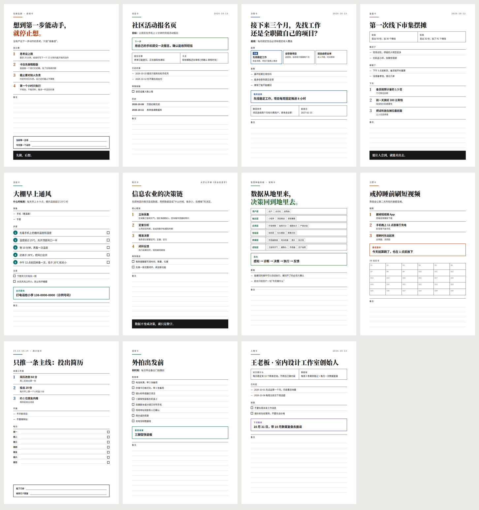
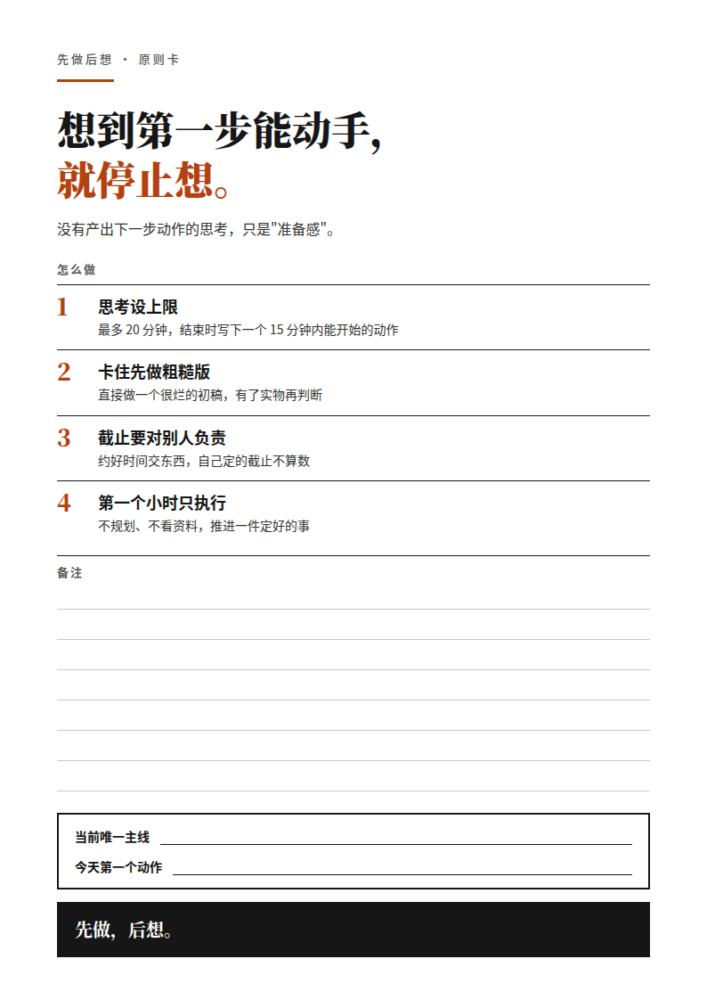
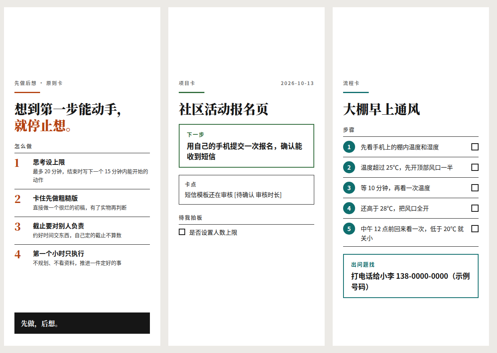

# One Page Card · 一页卡

**Turn long AI answers into one page you will actually look at.** One Page Card is an agent skill plus a dependency-free renderer. The agent picks one of **11 card types**, writes a few hundred characters of plain text, and the fixed template lays it out as a printable **A4 / A5** page, a **phone wallpaper**, or a **desktop widget**.

[中文说明](README.zh-CN.md) · [Live demo](https://yyy8178.github.io/one-page-card/) · [Skill instructions](SKILL.md) · [Card types](TYPES.md)



## Card types

The agent chooses the type itself from the content; you never have to name it.

| Type | id | Use it for |
| --- | --- | --- |
| Principle | `principle` | A rule, method or decision criterion you want to see every day |
| Project | `project` | Resume a project after a break: goal, status, one next step, blocker, decisions, history |
| Decision | `decision` | Compare options against your bottom line, record the choice and when to revisit |
| Review | `review` | After something ends: goal vs result, what worked, what to do next time |
| SOP | `sop` | Step-by-step instructions someone else can follow, with tick boxes |
| Knowledge | `knowledge` | A concept or framework from a course or book, tied to your own actions |
| System map | `map` | Layers of a system and how data or work flows through it |
| Habit | `habit` | Rules that rely on environment, a minimum version, and a 7–60 day tracker |
| Weekly plan | `week` | At most three priorities, what not to do, and a line for every day |
| Checklist | `checklist` | Items to check every time before a recurring task |
| Person | `person` | A client, partner or family member: what they want, agreements, next contact |

Types live in [`types.json`](types.json). Each type is a list of fields, and each field uses one of 17 layout kinds (numbered points, steps, options, layers, tracker, handwriting lines…). Adding a type means adding a JSON entry and an example, not writing code.

## Why it saves tokens

- The agent writes only plain text in a fixed format; it never writes HTML.
- It reads only the skeleton of the one type it chose (`render.py --skeleton <id>` or one section of `TYPES.md`), not every format.
- Each type has a character limit, and updates change only the lines that changed.

## Quick start

### With an agent

Install the repository as a skill. For Codex:

```bash
git clone https://github.com/YYY8178/one-page-card.git ~/.codex/skills/one-page-card
```

Then say **"Turn this into a one-page card: …"** or **"Update my project card with these notes: …"**. Agents that do not discover skills can read [SKILL.md](SKILL.md) directly. A chat-only agent can follow its steps and return card text; paste it into the [live demo](https://yyy8178.github.io/one-page-card/).

### Render from the command line

```bash
python3 render.py examples/project.txt                 # A4 page -> examples/project.html
python3 render.py card.txt --size phone                # a4 | a5 | phone | widget
python3 render.py card.txt --png                       # also export PNGs (needs Playwright)
python3 render.py card.txt --save cards/               # keep dated versions per card
python3 render.py --list                               # list types
python3 render.py --skeleton decision                  # print one type's skeleton
```

Open the HTML in a browser. The toolbar switches sizes; each card shows its character count and warns if it no longer fits on one page. To print, choose the matching paper, set margins to **None**, and enable **Background graphics**. Separate cards with a line containing `----`; each prints on its own page. Empty space on A4/A5 becomes ruled lines for handwritten notes.

`render.py` uses only the Python standard library (PNG export is optional). The HTML works offline with system fonts: no server, account, API key or external request.

| Printable A4 | Phone wallpaper |
| --- | --- |
|  |  |

## Files

| File | Purpose |
| --- | --- |
| [SKILL.md](SKILL.md) | Agent instructions: choose a type, fill its skeleton, keep it short |
| [TYPES.md](TYPES.md) | Skeleton for every type (generated) |
| [types.json](types.json) | Single source of truth for types, fields and layouts |
| [render.py](render.py) | Command-line renderer, archiver and PNG exporter |
| [template.html](template.html) | Self-contained page: editor, renderer, print styles (generated) |
| [examples/](examples) | One example per type |
| [src/template.src.html](src/template.src.html) | Template source |
| [tools/build.py](tools/build.py) | Regenerates `template.html`, `docs/index.html`, `TYPES.md` |
| [tools/check.py](tools/check.py) | Renders every example in every size and checks fit, page count and mobile width |

After editing `types.json` or the template source, run `python3 tools/build.py` and then `python3 tools/check.py`.

## Questions

**Is this an AI summarizer?** No. Your agent selects and writes the content; this repository provides the instructions, text format, template and deterministic renderer. It does not call any AI API.

**Can I use another agent?** Yes. Any agent that can read `SKILL.md` can follow it. Chat-only agents output the plain-text format for the browser editor.

**Do I have to say which type I want?** No. The agent picks it; the renderer also detects the type from the field names if the `类型：` line is missing, so v0.1 cards still render.

**Can I add my own type?** Yes. Add an entry to `types.json`, add `examples/<id>.txt`, run `tools/build.py` and `tools/check.py`.

## License

[MIT](LICENSE). If this saves you from rereading a long AI response, a GitHub star helps others find it.
